# MCP Image to 3D


One image of an object in, one 3D Gaussian-splat `.ply` out. A small Docker service around the
[speridlabs/idol](https://huggingface.co/speridlabs/idol) model: web gallery, in-browser 3D viewer,
HTTP API and an MCP server. No accounts, no cloud — it runs fully offline once the weights are
downloaded once.

Repository: <https://github.com/hypersniper05/MCP_Image_to_3D>

## Quick start

```bat
install.bat          (Windows)
bash install.sh      (Linux)
```

The installer checks Docker and Python, downloads the weights, builds the image and waits until the
service is ready. Then open <http://localhost:8043>.

You need: an NVIDIA GPU with ~10 GB free VRAM (measured on a 10 GB RTX 3080), Docker, ~16 GB disk,
and a Hugging Face account that has accepted the
[DINOv3 terms](https://huggingface.co/facebook/dinov3-vith16plus-pretrain-lvd1689m).

## The gallery

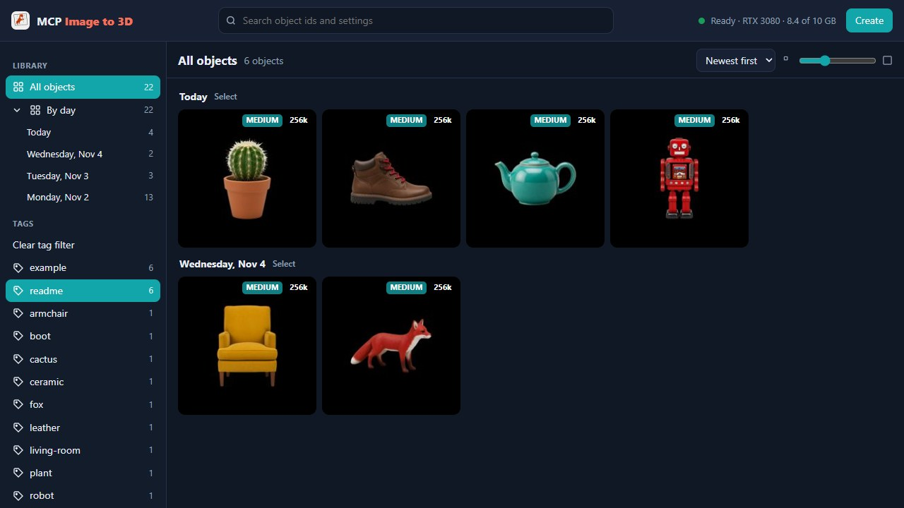

Tag objects, search, download or zip them. Trash is soft until purged, and tags are what make a
library findable.

## Create a model from an image

1. Get an image of one object. Keep the whole object inside the frame, on a plain light background
   or as a transparent cut-out. [MCP Image Generator](https://github.com/hypersniper05/MCP-Image-Generator-Uncensored) can make one from a sentence; see
   [Need object photos?](#need-object-photos).
2. Open <http://localhost:8043> and press **Create**.
3. Choose a file or paste an image URL, pick a quality, and press **Create**.
4. Wait for the job to finish, about 44 s on a 10 GB RTX 3080 at the `medium` preset. The new
   object then appears in the gallery; open it to see it in 3D.

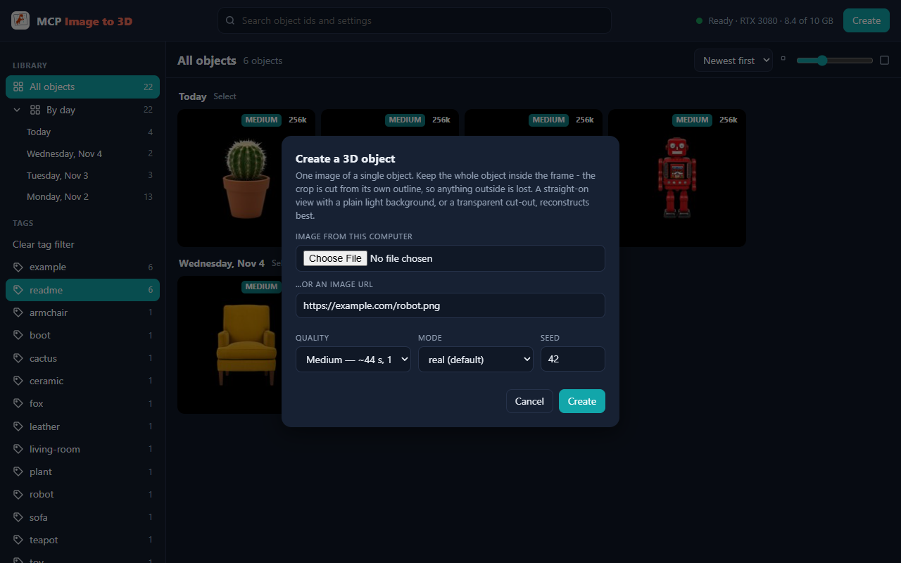

From an MCP client, the same job is one `idol_generate_3d` call:

```json
{
  "image": "https://example.com/robot.png",
  "mode": "real",
  "quality": "medium",
  "seed": 11,
  "tags": ["robot", "toy"]
}
```

It returns a job id right away; `idol_job` then reports `done` with a `view_url` for the viewer and
a `download_url` for the `.ply`. Over the HTTP API:

```bash
curl -X POST http://localhost:8043/jobs \
  -H 'Content-Type: application/json' \
  -d '{"image": "https://example.com/teapot.png", "quality": "medium", "seed": 22, "tags": ["teapot"]}'
```

## The viewer page

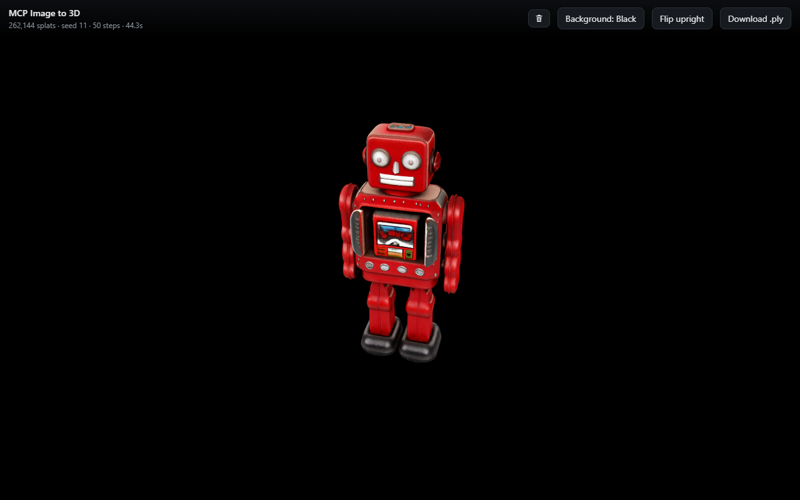

Every object has its own page at `/viewer/{id}`. The picture above is an actual render of the
generated robot, not a mockup. The top bar shows the splat count, seed, steps and generation time,
with buttons to delete the object, change the background, flip it upright and download the `.ply`.
Drag to orbit, scroll to zoom, right-drag to pan. `B` switches the background, `I` shows info, and
`←`/`→` navigate.

## Examples

The input images were made with [MCP Image Generator](https://github.com/hypersniper05/MCP-Image-Generator-Uncensored)
([more below](#need-object-photos)).

**The two right-hand columns are actual renders, not mockups or retouched images.** Each one is an
unedited screenshot of the generated `.ply` in this project's viewer. The right column is the same
model turned with the viewer's orbit control, showing it from an angle the input image never had.

All four were built through the MCP tool at the `medium` preset: 262,144 splats, about 44 s each on
a 10 GB RTX 3080.

<table>
  <tr><th>Input image</th><th>Actual render</th><th>Same model, rotated</th></tr>
  <tr><td colspan="3"><b>Tin toy robot</b></td></tr>
  <tr>
    <td></td>
    <td>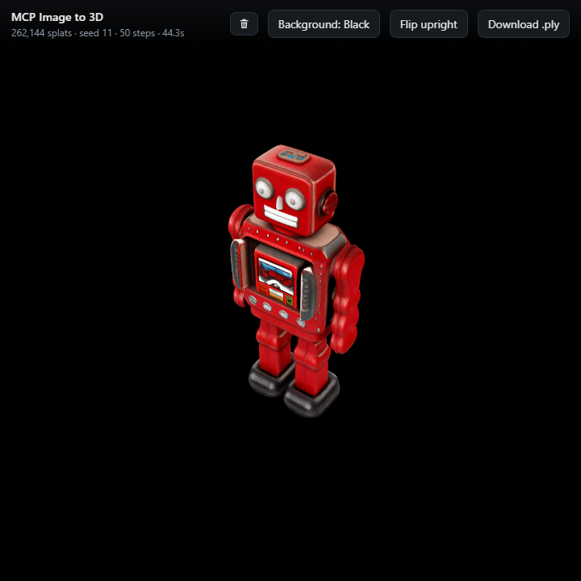</td>
    <td>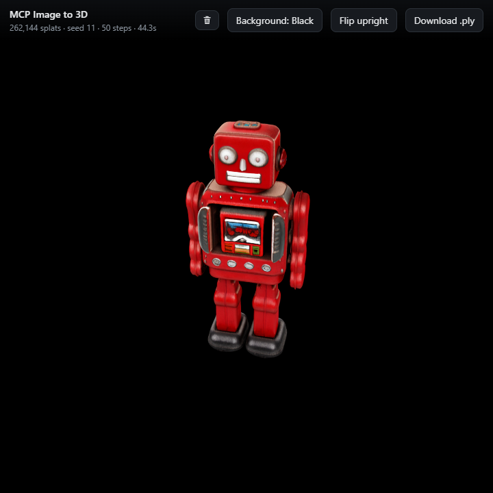</td>
  </tr>
  <tr><td colspan="3"><b>Ceramic teapot</b></td></tr>
  <tr>
    <td>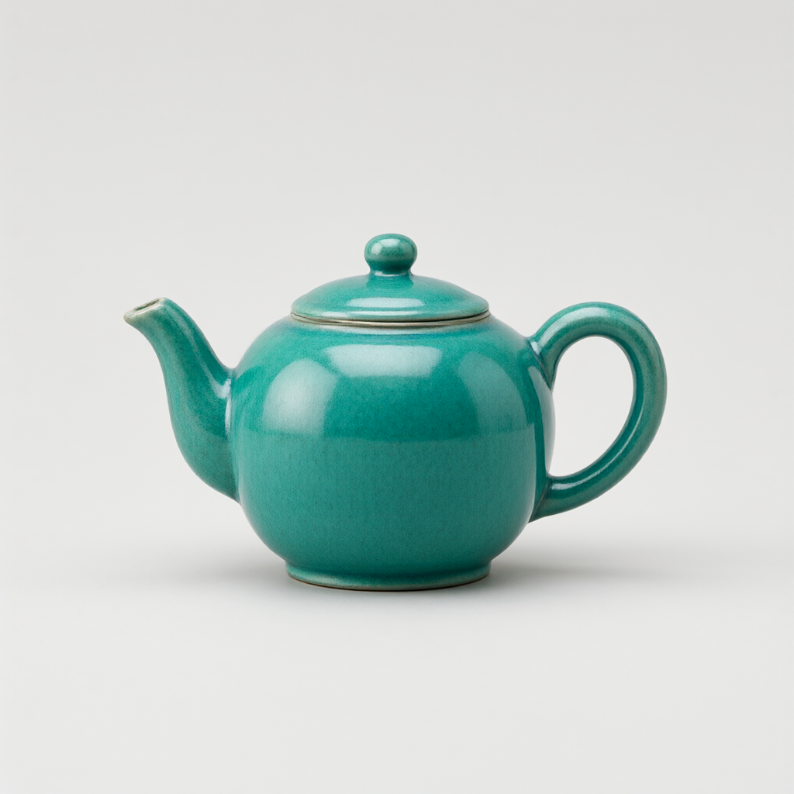</td>
    <td>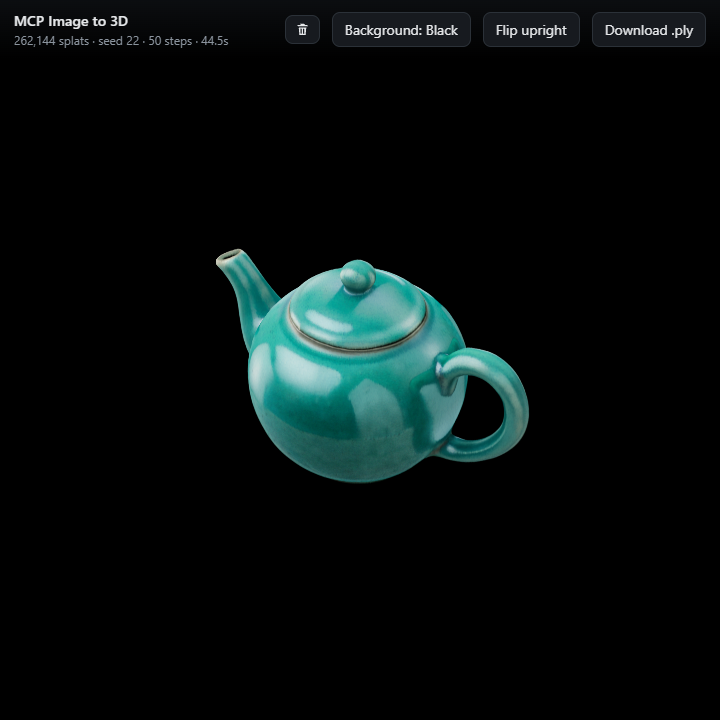</td>
    <td>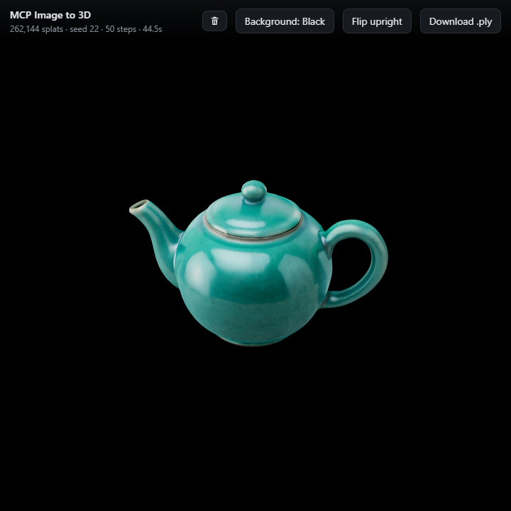</td>
  </tr>
  <tr><td colspan="3"><b>Leather boot</b></td></tr>
  <tr>
    <td>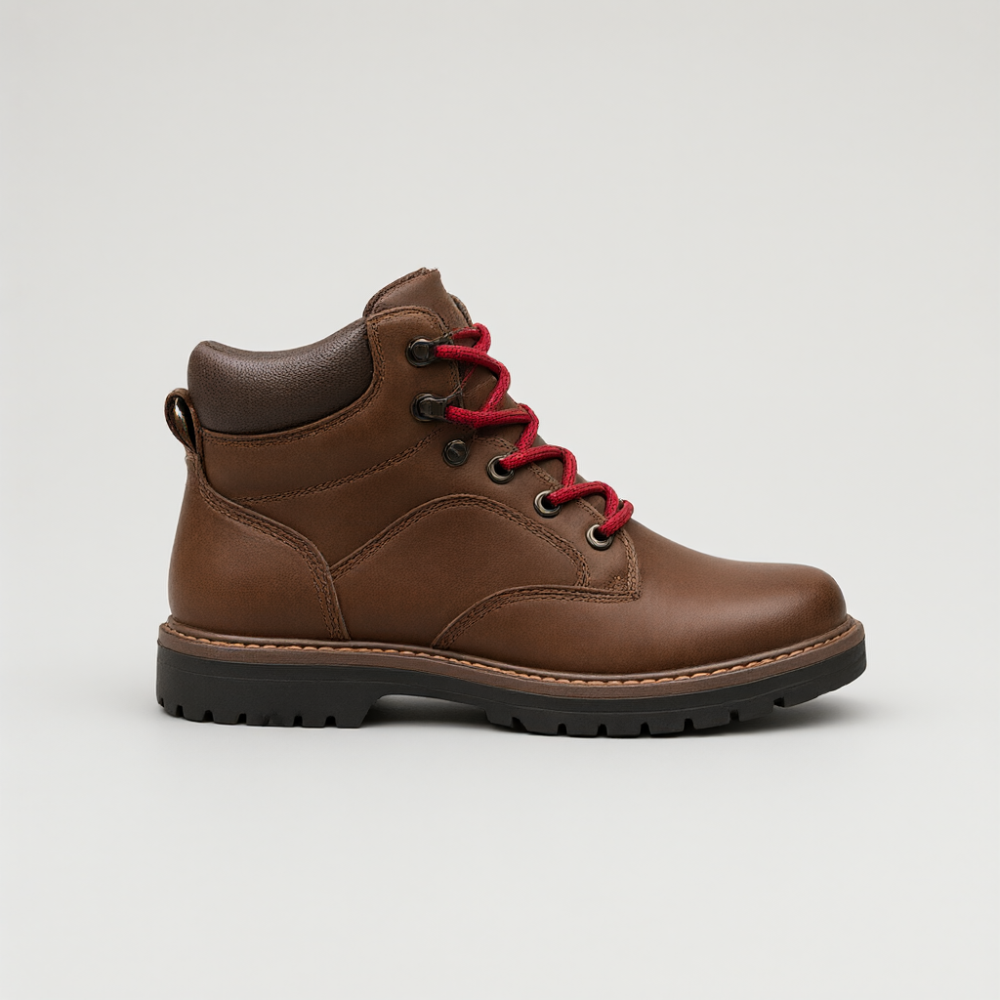</td>
    <td>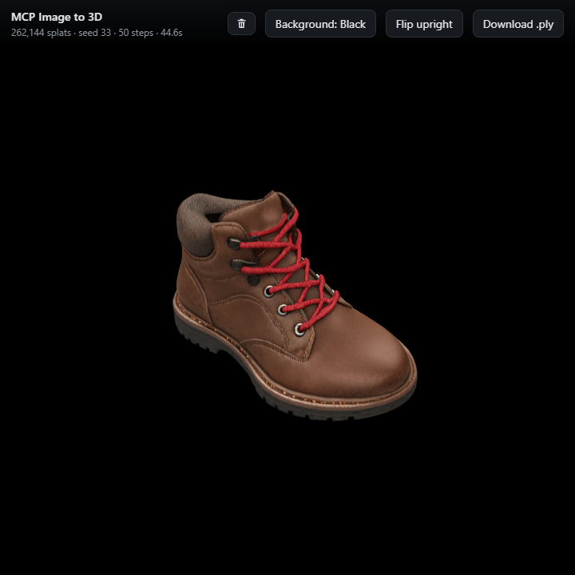</td>
    <td>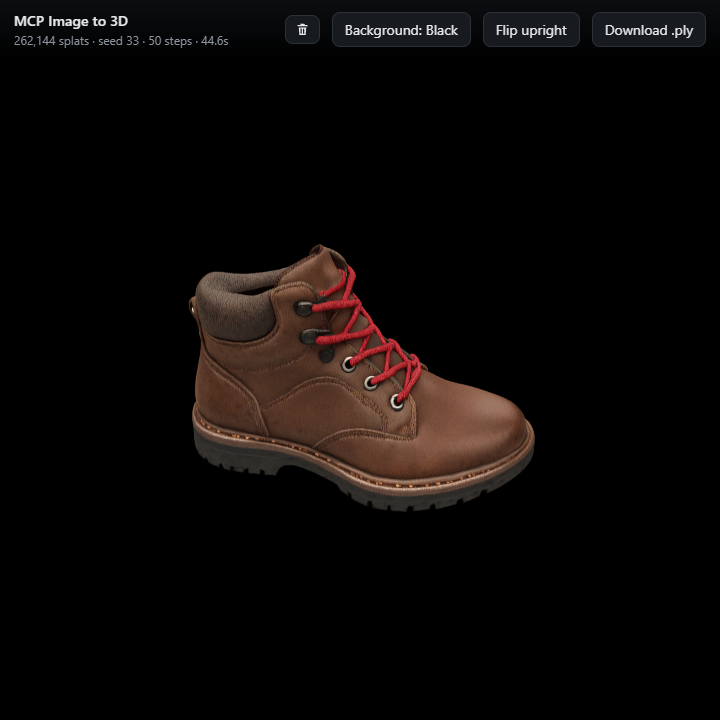</td>
  </tr>
  <tr><td colspan="3"><b>Potted cactus</b></td></tr>
  <tr>
    <td></td>
    <td>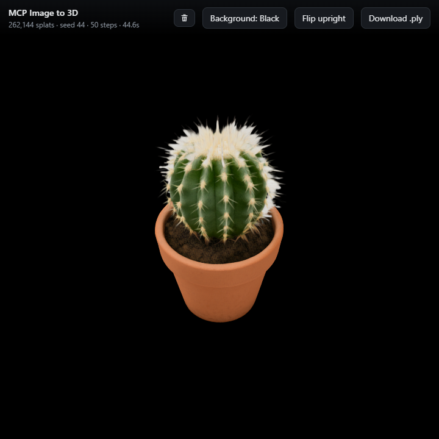</td>
    <td>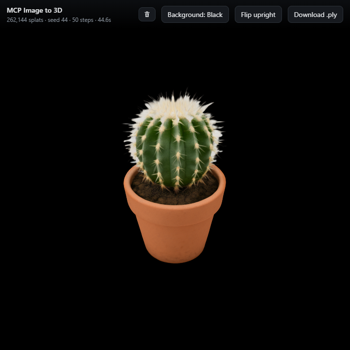</td>
  </tr>
</table>

## MCP

Endpoint: `http://<host>:8043/mcp` (Streamable HTTP). With pi:

```bash
pi mcp add mcp-image-to-3d --url http://127.0.0.1:8043/mcp
```

| Tool | What it does |
| --- | --- |
| `idol_generate_3d` | Start a generation from a URL, data URI or server path. Takes `mode`, `quality`, `seed`, `steps`, `num_gaussians`, `tags`, `wait_seconds` |
| `idol_job` | Job status, with `view_url` and `download_url` when done |
| `idol_objects` | List finished objects, newest first |
| `idol_status` | Model state, GPU, VRAM, queue and parameter ranges |

## Need object photos?

Use [MCP Image Generator](https://github.com/hypersniper05/MCP-Image-Generator-Uncensored), the
companion self-hosted MCP server (Qwen-Image-2.1, from 4 GB VRAM): text to image, editing, photo
restoration, transparent PNGs, seamless tiles, 360 panoramas, upscaling, watermark removal, SVG
export and optional video. Ask it for a product photo of your object and pass the file or URL
straight to `idol_generate_3d` — the input images in this README were made that way.

The robot above came from this prompt. Everything after the first sentence is framing that suits
this service, so reuse it for any object:

> Studio product photograph of a vintage red tin wind-up toy robot standing upright, with a square
> head, round silver eyes, riveted painted metal body and short arms held at its sides. The whole
> object is visible and centred with generous empty margin on every side, photographed straight on
> at the object's own height, on a plain light grey seamless studio background, with soft even
> lighting. One single object, no text, no props.

<details>
<summary>HTTP API</summary>

| Method | Path | Purpose |
| --- | --- | --- |
| `GET` | `/` | Gallery page |
| `GET` | `/viewer/{id}` | Interactive 3D viewer for one object |
| `GET` | `/objects/{file}` | The `.ply`, the preprocessed input image or its thumbnail. Add `?trash=1` for a trashed object |
| `POST` | `/jobs` | Start a generation |
| `GET` | `/jobs/{id}` | Job status, with `view_url` and `download_url` when done |
| `GET` | `/jobs` | Finished objects, newest first |
| `GET` | `/health` | Readiness, GPU, VRAM, queue and parameter ranges |
| `GET` | `/api/objects` | Gallery data, including tags and thumbnails |
| `GET` | `/api/trash` | Trashed objects |
| `POST` | `/api/trash` | `{"ids": ["..."]}` — move objects to the trash |
| `POST` | `/api/restore` | `{"ids": ["..."]}` — restore trashed objects |
| `POST` | `/api/purge` | `{"ids": ["..."]}` — delete for good; omit `ids` to empty the trash |
| `POST` | `/api/tags` | `{"id": "...", "add": ["sofa"], "remove": ["old"]}` — tags are merged server-side |
| `POST` | `/api/upload?name=x.png` | Raw image bytes; returns a path to pass to `/jobs` |
| `POST` | `/api/zip` | `{"ids": ["..."]}` — bundle several `.ply` files into one zip |

A generation request:

```json
{
  "image": "https://example.com/object.png",
  "quality": "medium",
  "mode": "real",
  "seed": 42,
  "tags": ["sofa", "living-room"]
}
```

`image` can be an HTTP(S) URL, a `data:` URI, or a path already on the server (for example a file
returned by `/api/upload`). The job is asynchronous; poll `/jobs/{id}` or use the MCP
`wait_seconds` argument.

Links are built from the `Host` header, so a link made from a LAN address comes back with that
address. Set `IDOL_PUBLIC_BASE_URL` to force one address into every link when the service sits
behind a proxy.

</details>

<details>
<summary>Configuration</summary>

| Variable | Default | Notes |
| --- | --- | --- |
| `CUDA_VISIBLE_DEVICES` | `0` in compose | GPU index or `GPU-<uuid>`. A UUID is more stable when several cards are installed |
| `IDOL_PORT` | `8043` | HTTP port |
| `IDOL_DATA` | `/data` | Jobs, uploads, objects and trash |
| `IDOL_MODEL_DIR` | `/data/idol-local` | Local model folder prepared by `tools/prepare_local_weights.py` |
| `IDOL_MAX_GAUSSIANS` | `262144` | Server default; the compose file raises it to `1048576` |
| `IDOL_PUBLIC_BASE_URL` | empty | Forces one base URL into every generated link |
| `IDOL_ALLOWED_HOSTS` | empty | Optional MCP DNS-rebinding allowlist, comma-separated |
| `IDOL_OPTIMIZE` | `1` | `torch.compile`; set `0` to disable, at roughly 1.7× slower sampling |
| `IDOL_WARMUP` | `1` | Runs a small warmup before accepting work |
| `IDOL_IDLE_UNLOAD_SECONDS` | `600` | Frees the GPU after this many seconds without a job; the next job reloads the model. `0` keeps it loaded |
| `HF_HOME` | `/data/hf-cache` | Hugging Face cache inside the container |
| `HF_HUB_OFFLINE` | `1` | Runtime does not contact Hugging Face |

If you have more than one GPU, check `nvidia-smi -L` and set `CUDA_VISIBLE_DEVICES` to the
`GPU-<uuid>` you want. Docker Desktop on Windows cannot isolate a single GPU from the host, so
the variable is what selects the card inside the container. `/health` reports the device name it
actually received.

</details>

<details>
<summary>Quality, speed and the parameters</summary>

Measured on this service with the same fox image and seed after warm-up. The 3080 column is a
10 GB RTX 3080; the 5090 column is a 32 GB RTX 5090.

At 50 steps on the RTX 3080, more splats barely changed time or memory:

| Splats | Time | `.ply` | Resident VRAM | Splats above 0.1 opacity |
| --- | --- | --- | --- | --- |
| 262,144 | 43.9 s | 17.8 MB | 7,330 MiB | 71.1% |
| 524,288 | 44.3 s | 35.6 MB | 7,334 MiB | 56.4% |
| 1,048,576 | 46.0 s | 71.3 MB | 7,334 MiB | 49.0% |

The extra splats sample the same surface more densely and add mostly faint haze, which is why the
default is 262,144: same geometry at a quarter of the file size.

The quality presets move steps and splat count together:

| Preset | Steps / splats | RTX 3080 | RTX 5090 | `.ply` | Use for |
| --- | --- | --- | --- | --- | --- |
| `low` | 25 / 32,768 | 23 s | 9.1 s | 2 MB | Testing a design |
| `medium` | 50 / 262,144 | 43.9 s | 18.1 s | 17.8 MB | Default |
| `high` | 100 / 1,048,576 | 87 s | 27.4 s | 68 MB | Final asset |

Pass `steps` or `num_gaussians` explicitly to move one axis on its own; they override the preset.
Without the compose file, `IDOL_MAX_GAUSSIANS` defaults to 262,144, which caps the `high` preset.

`mode` is a crop setting, not an image type: `synthetic` frames the object at 1/1.2 of a 1024²
square, `real` at 1/1.7. On the reference machine `real` produced cleaner geometry on every input
tested, including a flat render (sofa: 96.2% vs 89.3% well-defined surface; fox render: 46.3% vs
41.0%). This deliberately differs from the model card, which recommends `synthetic` for renders.
The other knobs (`steps` 25–100, `cfg_strength` 1–7, `rescale_t` 1–5) moved the output geometry
measurably not at all; the SDK defaults are fine.

Input images:

- Keep the whole object inside the frame; the crop cannot invent what is outside.
- A straight-on view at the object's own height beats a high or angled view.
- No alpha channel: use a plain light background (segmentation does poorly on dark).
- Real alpha: the background is discarded, a cut-out works as well.
- The image is resized to 1024×1024, so a larger file buys nothing.

The opacity metric above ranks cleanliness but is biased by splat count; it is only valid when
comparing equal `num_gaussians`.

</details>

<details>
<summary>Viewer notes</summary>

The viewer (`web/viewer.html`) uses three.js and GaussianSplats3D, both vendored in `web/vendor`,
so it needs no CDN.

The WASM sorter's shared-memory path needs `SharedArrayBuffer`, which needs a cross-origin-isolated
page — and Chrome ignores the isolation headers on plain HTTP. The viewer passes
`sharedMemoryForWorkers: self.crossOriginIsolated`, which selects the non-shared sorter on
`http://<lan-ip>:8043`; behind HTTPS the faster path comes back on its own.

`Gaussian.save_ply` rotates the object's `+Z` onto `-Y`, so the viewer defaults to `-Y` up and has
a **Flip upright** button (`?up=y`). If an object looks wrong in an external viewer, check that
viewer's up axis first. The viewer also drops splats below alpha 5/255 — roughly half of Idol's
output, which reads as haze; the `.ply` itself is untouched.

</details>

<details>
<summary>Limits and security</summary>

- **One job at a time.** The pipeline seeds globally and mutates module-level state, so all calls
  are serialised behind one lock.
- **`num_gaussians` is capped** (262,144 default; compose sets `IDOL_MAX_GAUSSIANS=1048576`).
  Above the octree's anchor density you pay in file size, not detail.
- **No fp8 or 4-bit path.** The SDK runs fp16; an sm_86 card such as the RTX 3080 has no fp8
  tensor cores.
- **`torch.compile` is on by default** (`IDOL_OPTIMIZE=0` turns it off).
- **The model leaves the GPU when idle.** After `IDOL_IDLE_UNLOAD_SECONDS` (10 minutes by default)
  without a job, `/health` reports `state: unloaded` with `ready` still `true`. Only jobs count as
  activity, so polling `/health` or browsing the gallery does not keep the model loaded. Unloading
  frees about 6 GB of VRAM; about 0.3 GB stays for the CUDA context. The next job reloads the model
  first, which adds 22–25 s on an RTX 3080, and shows `waiting for model` meanwhile.
- **Seeds repeat, with one exception.** The same seed and settings give a byte-identical `.ply`,
  including across idle unloads. The first run after the `torch.compile` cache is created, such as
  right after install, can differ from later runs.
- **No authentication, no TLS.** Built for a trusted LAN or tailnet; behind a reverse proxy add
  HTTPS and access control. The MCP transport has an optional DNS-rebinding allowlist via
  `IDOL_ALLOWED_HOSTS`.

</details>

<details>
<summary>Tools and tests</summary>

| Script | Purpose |
| --- | --- |
| `tools/prefetch.py` | Downloads Idol, DINOv3 and the FLUX.2-klein VAE into `data/hf-cache` |
| `tools/prepare_local_weights.py` | Copies the model into `data/idol-local` and repoints the VAE |
| `tools/test_e2e.py` | Waits for readiness, submits an image, polls and prints the links |
| `tools/test_mcp.py` | Checks the MCP endpoint with both protocol eras |
| `tools/preview_ply.py` | Renders a `.ply` to PNG without a GPU or browser |
| `tools/sweep_run.py` / `tools/sweep_report.py` | The parameter sweep used to choose the defaults |
| `tools/compare_inputs.py` | Compares output quality across input-image variants |

```bash
python tools/test_e2e.py --image path/to/object.png
python tools/test_mcp.py
```

</details>

<details>
<summary>Troubleshooting</summary>

- **Not ready:** `/health` reports `loading` → `warming` → `ready` (~90 s). Errors are in the
  `error` field and in `docker compose logs mcp-image-to-3d`. `unloaded` is normal: the model left
  the GPU while idle and the next job reloads it.
- **Viewer sits on "Loading":** on plain HTTP check that `/vendor` files are served; try
  `/viewer/{id}?up=y`.
- **Object on its side:** **Flip upright** or `?up=y` — camera up axis only, the `.ply` is
  unchanged.
- **MCP returns 421:** set `IDOL_ALLOWED_HOSTS` to the host names you use, or leave it empty on a
  trusted network; behind a proxy set `IDOL_PUBLIC_BASE_URL`.
- **Wrong GPU:** set `CUDA_VISIBLE_DEVICES` (index or UUID) and restart; `/health` shows the card.
- **Out of VRAM:** lower `IDOL_MAX_GAUSSIANS`, use the `low` preset, or close other GPU work.

</details>

## License and credits

The service code in this repository is MIT-licensed; see `LICENSE`. The Idol model and SDK are
Apache-2.0, DINOv3 has its own license terms, FLUX.2-klein-4B is Apache-2.0, and the bundled
viewer libraries (`three.js`, `GaussianSplats3D`) keep their upstream licenses.

The example images were made for this project with
[MCP Image Generator](https://github.com/hypersniper05/MCP-Image-Generator-Uncensored).
